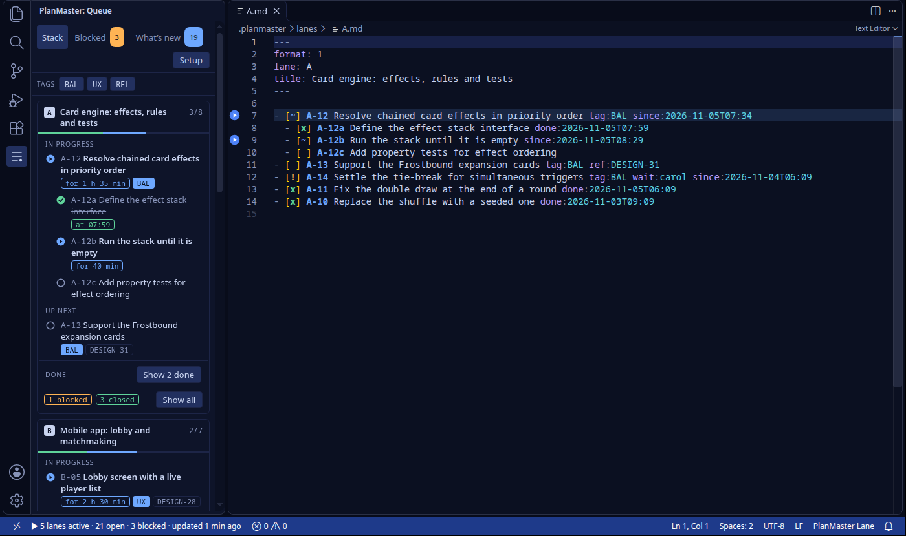
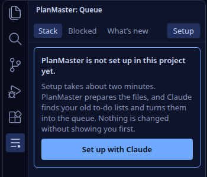
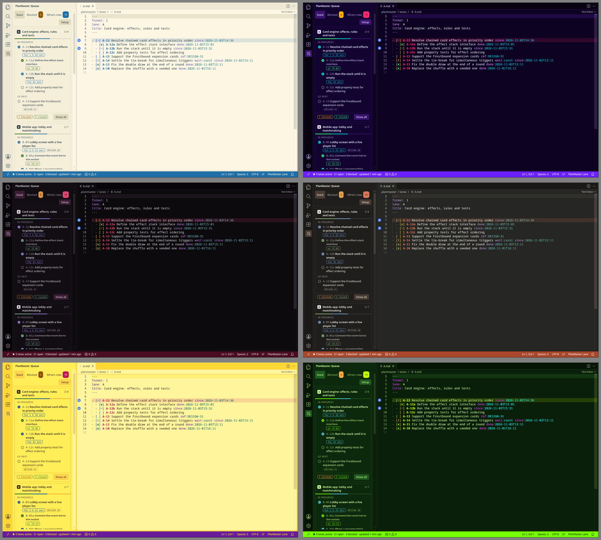

# PlanMaster

A VS Code extension that shows the work of your Claude Code chats as one queue: what each chat is doing right now, what comes next, what is blocked and on whom, what was closed, and what changed since you last looked.



The project in the pictures is invented.

## Why

Once you run more than one Claude Code chat on a project, the state of the work gets scattered. Each chat knows its own part, and the overview lives in a to-do file you keep up to date by hand, or don't. PlanMaster gives that overview a fixed format that Claude writes itself, and a view that reads it.

## How it works

Every chat owns a lane, which has a short ID and a precise title. A lane is one plain-text file in `.planmaster/lanes/`, written by the chat that owns it:

```markdown
---
format: 1
lane: B
title: Mobile app: lobby and matchmaking
---

- [~] B-05 Lobby screen with a live player list ref:DESIGN-28 since:2026-11-03T13:30
  - [x] B-05a Connect the room list to the socket done:2026-11-03T14:20
  - [~] B-05b Show a reconnecting banner when the socket drops since:2026-11-03T15:50
- [!] B-06 Invite links that open the app directly wait:carol since:2026-11-02T17:30
```

`[ ]` is todo, `[~]` in progress, `[!]` blocked, `[x]` done and `[-]` dropped. Children are indented by two spaces. A blocked item says who it is waiting for with `wait:`, which takes a person from a list in `config.json` or the ID of another item. Timestamps are local time and come from the clock, never from the model's guess.

The extension only reads these files. It checks them against the format, draws them, and tells Claude how to write them. The files are committed with your project, so the history of the work lives in version control and no second store can drift out of sync.

## What you get

The queue view has three tabs. Stack shows each lane with its item in progress, what is up next and how many items are blocked or closed. Blocked lists everything that is waiting, with the person or item and for how long. What's new lists what changed since you last pressed Mark Everything as Seen.

In the editor, a lane file gets:

- errors and warnings in the Problems panel, one rule per mistake (the rules are numbered PM001 to PM021 in the specification);
- a warning when an item has been in progress for a long time and its file has not changed, which usually means the chat stopped without saying so;
- a status bar summary, a gutter marker on the lines in progress, and syntax colors for each state;
- hover and go to definition on `wait:` references.

Text from lane files is treated as untrusted. The view never builds HTML from it, and it only opens files the extension has already read.

## Install

PlanMaster is not on the Marketplace. Download `planmaster-<version>.vsix` from the [latest release](https://github.com/carloalbertogiordano/PlanMaster/releases/latest), then install it with

```sh
code --install-extension planmaster-<version>.vsix
```

or, in VS Code, open the Extensions view, choose Install from VSIX in the "..." menu, and pick the file. Then run Developer: Reload Window. You need VS Code 1.90 or later.

To build it yourself you also need Node 20 or later:

```sh
git clone https://github.com/carloalbertogiordano/PlanMaster.git
cd PlanMaster
npm install
npm run package
code --install-extension dist-vsix/planmaster.vsix
```

To update an installed copy, install the new file again with `--force` and reload the window.

## Getting started

Open a project and click the PlanMaster icon in the activity bar. If there is no queue yet, the view says so and offers one button.



1. Press Set up with Claude and answer the few questions. PlanMaster creates its files, adds a short note to your `CLAUDE.md` between two marker comments (you see the diff first, and nothing outside the markers is touched), and asks whether it should check Claude's work automatically.
2. PlanMaster copies one message. Paste it into a Claude chat in the project. Claude looks for your old to-do lists, proposes how to split them into lanes, and asks before it writes anything.
3. Start each chat bound to its lane, for example `PLANMASTER_LANE=B claude`, so that it knows which file is its own.

You can go through the setup again at any time with the Setup button in the view, or with PlanMaster: Set Up with Claude (Guided) from the command palette. The individual steps are also commands of their own: initialize the workspace, install the instructions, install the hooks, and copy a single prompt (start a lane, migrate a to-do file, turn a plan into items, reconcile a lane with reality, archive old items).

### Hooks

The hooks are optional. They make Claude Code check its own work: when a chat saves a lane file with errors, the errors go straight back to that chat, and a chat that tries to stop with errors in its lane, or with an item that has sat in progress for too long, is asked about it once. The hook is a single file that runs with `node`, so Node has to be installed on the machine where Claude Code runs. Without hooks, nothing needs to be installed beyond the extension.

## Color themes

Seven themes come with the extension. Each one styles the editor, the queue view and the status bar, and gives the five item states their own colors. Two of them are jokes, and a test checks the contrast of every pair of colors that matters in all seven, so the jokes stay readable.



| Theme | Kind | What it is |
|---|---|---|
| PlanMaster Midnight | dark | Deep blue and calm. The sensible one. |
| PlanMaster Solar | light | Warm paper with dark teal text. |
| PlanMaster Cyberpunk | dark | Neon pink and cyan on night purple. |
| PlanMaster Goth | dark | Near black, blood red, a candle's worth of light. |
| PlanMaster Claude | dark | Warm charcoal with a terracotta accent. Unofficial. |
| PlanMaster Banana Panic | light | Everything is yellow. The text is dark brown, so it is still readable. |
| PlanMaster Radioactive Pickle | dark | Lime on dark green, with more glow than any editor needs. |

The theme files in `themes/` are generated from `src/themes/palettes.ts` with `npm run themes`.

## Command-line checker

The checker works without VS Code, which makes it usable in CI:

```sh
npm install
npm run build
node out/cli/main.js <workspace-or-.planmaster-dir>
```

Findings go to stderr as `file:line severity code message` and a summary goes to stdout. The exit code is 0 when there are no errors, 1 when there is at least one, and 2 for usage or configuration errors. `--json` prints the findings as JSON.

## Documents

| Document | Contents |
|---|---|
| [docs/spec/queue-format.md](docs/spec/queue-format.md) | The file format: markers, tokens, hierarchy, IDs, archive and lint rules. This is the normative text. |
| [docs/spec/extension.md](docs/spec/extension.md) | What the extension does: views, editor integration, commands, security and milestones. |
| [docs/spec/claude-integration.md](docs/spec/claude-integration.md) | How Claude is instructed and how deviations are detected. |
| [docs/prompts/](docs/prompts/) | The exact prompts, and the block installed in `CLAUDE.md`. |
| [docs/examples/demo-workspace/](docs/examples/demo-workspace/) | A five-lane queue used as a test fixture. |
| [docs/mockup/queue-view.html](docs/mockup/queue-view.html) | An interactive mockup of the queue view. Open it in a browser. |

## Contributing

Contributions are welcome. The rules every change follows (the Red-Green-Refactor method, the layout of `src/`, the limits on code smells and the commit rules) are in [CLAUDE.md](CLAUDE.md). Claude Code reads that file by itself, and it is just as useful to read by hand. Please read it before opening a pull request.

The code is TypeScript, tested first with Vitest, and kept honest by ESLint (with SonarJS), jscpd for duplication and knip for dead code. The extension is also run inside a real VS Code under a virtual display, both from source and from the packed `.vsix`. `npm run check` runs all of it, and it is what to run before a commit. `npm run preview` and `npm run look` draw the queue view in headless Chrome and in the real editor, which is how the pictures above were taken.

## License

PlanMaster is free software under the [GNU General Public License, version 3](LICENSE).
