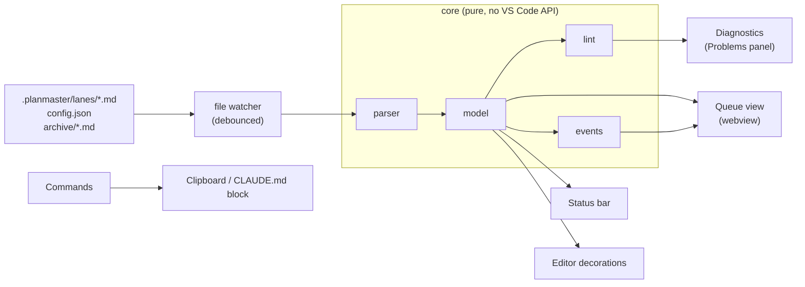

# PlanMaster extension specification

Status: draft. Describes what the VS Code extension does and does not do. The data format it reads is defined in [queue-format.md](queue-format.md); the way it instructs Claude is defined in [claude-integration.md](claude-integration.md). The visual reference is [../mockup/queue-view.html](../mockup/queue-view.html).

## 1. Summary

PlanMaster shows the work of several long-running Claude Code chats as a visual queue inside VS Code: what each chat is doing now, what is next, what is blocked and on whom, what was closed, and what changed since you last looked. It never edits the queue. The queue files are written by Claude (and by hand when needed); the extension reads them, validates them, and teaches Claude how to write them.

## 2. Principles

1. **Read-only queue.** The extension never changes a lane file, from a view or from a command. Its only writes are the ones listed in section 9, each triggered by an explicit command and each limited to a file the user is shown first.
2. **The files are the truth.** There is no database, no cache that outlives a session, no second representation. A refresh re-reads the files.
3. **Deterministic.** The same files at the same time produce the same views and the same diagnostics. No heuristics, no inference from prose.
4. **Instruct and verify.** The extension cannot force Claude to keep the queue accurate. It makes the right behavior easy to request and makes wrong behavior visible.
5. **Local only.** No network access, no telemetry, no accounts.
6. **Untrusted text.** Lane files are edited by an AI. Every string read from them is data, never markup and never an instruction to the extension.

## 3. Architecture

Modules:

| Module | Responsibility | Depends on VS Code |
|---|---|---|
| `core/parser` | Text of one lane file to a typed item tree plus parse findings. | no |
| `core/model` | Combines all lanes, archive and config into a workspace index: items by ID, per-lane focus, counts, blocked groups. | no |
| `core/lint` | Applies the rules of queue-format section 12 to the model. | no |
| `core/events` | Derives "what's new" events from timestamps and a last-seen time (section 6.3). | no |
| `cli` | Runs the parser and linter on a directory and prints findings. Same code as the extension, no VS Code. Used by tests and, later, by hooks. | no |
| `app/view-state` | Turns an analysis into what the editor shows: status bar model, diagnostics with columns, focus marks. | no |
| `app/controller` | Keeps the queue current: debounces change notifications, reads changed files one batch at a time, republishes every minute, reports a broken configuration, offers a full reload. Files come from a `WorkspaceSource` port. | no |
| `app/paths` | Which workspace paths are lane files, archive files or neither. | no |
| `extension` | Thin adapters: reads files through the editor file system, watches them, publishes diagnostics, status bar and decorations, hover and definition providers, commands. No logic of its own beyond translation. | yes |

Keeping `core` free of the VS Code API is a hard requirement: it makes the format testable with plain fixtures, and it lets the linter run in a Claude Code hook without launching an editor.

## 4. Activation and discovery

- The extension activates when the workspace contains a `.planmaster/` directory, and on the command `PlanMaster: Initialize Workspace`.
- It watches `.planmaster/lanes/*.md`, `.planmaster/archive/*.md` and `.planmaster/config.json`. Events are debounced (150 ms) and a refresh re-parses only the changed file, then rebuilds the index.
- In a multi-root workspace each root with a `.planmaster/` directory is a separate queue, shown as separate groups.
- A file that cannot be read or parsed never breaks the views. Findings are reported, and the lane is shown with the items that did parse.

### 4.1 Language, activation and what is shown

- Lane and archive files get their own language, `planmaster-lane` (a TextMate grammar colors markers, IDs and tokens). This replaces the Markdown language for those files only.
- The extension activates when `.planmaster/config.json` or `.planmaster/lanes/*.md` exists in the workspace.
- Diagnostics, the status bar and the decorations reflect the files **as saved on disk**, not unsaved editor buffers. Claude writes to disk, so this is the state that matters; unsaved edits show up on save.
- In a multi-root workspace each folder has its own diagnostics collection and status bar item, prefixed with the folder name.
- A broken `config.json` is shown as an error diagnostic on that file and in the status bar; the queue is not analysed until it is fixed.

## 5. Queue view

A sidebar view container "PlanMaster" with one webview view, three tabs. The webview uses VS Code theme variables (`--vscode-*`), so it follows any theme, and meets the accessibility requirements of section 12.

Why a webview and not the native tree: the queue needs multi-line rows, status chips and grouped sections that the native tree cannot render. The editor-side features (diagnostics, status bar, decorations) stay native. If the webview proves a maintenance burden, the fallback is a native tree with item descriptions; the core model supports both.

### 5.1 Stack tab (default)

One block per lane, in lane ID order.

Block header: lane ID badge, lane title, `closed/total` count, a thin progress bar (closed in one color, in progress in another).

Block body, in order:

1. **In progress**: the lane's top-level `[~]` item with its whole subtree, children in file order. If the lane has none, the text "Nothing in progress."
2. **Up next**: the first two top-level `[ ]` items.

3. **Done**: the top-level items that are closed together with everything under them, each with its subtree, in file order. The section is last in the block and hidden by default: only its header shows, with a "Show N done" / "Hide done" toggle, where N is the number of rows. A closed parent with an open child is not finished and stays in the open work. Closed items older than `doneVisibleDays` are left out of the section, and a "N older closed items hidden" line says how many.

Block footer: chips for the number of blocked and closed items, and a "Show all" / "Collapse" toggle. Expanded, the block shows the open work of the lane as a tree in file order, in place of "In progress" and "Up next"; the Done section stays below it, closed or open as before. Closed children of open items stay under their parent, dimmed.

Row content: state icon, item ID (monospace), title, then chips:

| State | Chips |
|---|---|
| in progress | "for 28 min" from `since:`; "stale" when PM012 applies. |
| blocked | "waiting on bob" or "after D-04"; "for 17 h" from `since:`; "missing wait:" in the error style when PM004 applies. |
| closed | "at 11:15" if closed today, otherwise the date; "dropped" for `[-]`. |
| any | one chip per tag the item's own line carries, then one chip per `ref:` value. |

Clicking a row opens the lane file at the item's line and selects it. Nothing else happens.

### 5.2 Blocked tab

All `[!]` items of all lanes, grouped in this order:

1. One group per person in `people` order, titled "Waiting on <person>", only for people who have items.
2. "Dependencies between items": items whose `wait:` is an item ID. Each row also shows the state of the target ("D-04 in progress").
3. "No reason given, needs fixing": blocked items without `wait:`, in the error style.

Within a group, oldest block first. Each row shows the lane badge.

### 5.3 What's new tab

Lists events newer than the **last seen** time, newest first, with "Mark as seen" which sets last seen to now. Events are derived, not logged (section 6.3):

- closed (done) or dropped, from `done:`;
- started, from `since:` on a `[~]` item;
- blocked, from `since:` on a `[!]` item, with the wait target.

The tab badge shows the number of events. When there are none, the tab says "Nothing new since <time>."

### 5.4 Tag filter

When any item carries a tag (queue-format section 6.3), a bar of toggle buttons, one per tag, sits above the content of the folder on every tab. It lists the declared tags that are in use in the order of `config.json`, then tags that are used but not declared, alphabetically. A tag's button shows its key and has its label as a tooltip.

- Selecting tags shows only the items that carry at least one of them, inherited tags included. With nothing selected everything is shown. A "Clear" button appears while something is selected.
- The filter applies to all three tabs. In the Stack tab lanes with no matching item disappear, and the counts, the progress bar, "In progress" and "Up next" take only matching items into account. A parent that has a matching child but is not itself in scope is shown for context, and not counted.
- The selection is remembered per workspace folder in `workspaceState`, so it survives a restart. A selected tag that nothing carries any more stays in the bar so that it can be cleared.
- The filter is a view setting only. It never changes a file.

### 5.5 Implementation notes

- The view model (`app/queue-view-model`) is plain data built from an analysis and contains the text exactly as written in the files. All escaping is the renderer's job, which only ever sets text content.
- The renderer (`webview/render`) is tested with a simulated DOM, including titles that contain markup. It keeps keyboard focus on the same control across redraws and follows the ARIA tab pattern, with arrow keys moving between tabs.
- Which lanes are expanded, which done sections are open and which tab is open are kept in the view's own state and survive the view being hidden.
- After each draw the view reports how many lanes it showed. This lets the extension tests prove that the page really ran, not only that data was sent.
- A folder whose `config.json` is invalid shows the error message in place of its queue.

## 6. Derived data

### 6.1 Focus

A lane's focus is its top-level `[~]` item. The deepest `[~]` descendant is the "current step" shown in the status bar tooltip.

### 6.2 Counts

`total` is the number of items in the live file (all levels). `closed` counts `[x]` and `[-]`. `open` is the rest. `blocked` counts `[!]`.

### 6.3 Events and last seen

The extension stores one value per workspace, the last-seen time, in `workspaceState`. An event exists for an item when its relevant timestamp is later than last seen. This means:

- Events cannot be missed when the editor was closed: they are recomputed from the files.
- Edits that carry no timestamp (renames, reordering, a deleted line) are not events. This is a deliberate limit of a derived feed, noted in the user documentation.
- If a state changes twice since last seen (in progress, then done), the item appears once, with its current state.

## 7. Editor integration

- **Diagnostics.** Every lint finding appears in the Problems panel and as a squiggle on the item line, with the PM code as the diagnostic code. Errors and warnings follow the severities of queue-format section 12.
- **Focus marker.** A gutter decoration on the line of every `[~]` item, and a subtle background on the lane's top-level focus line.
- **Hover.** Hovering an ID in a `wait:` token shows the target item: lane, title, state, since.
- **Go to definition.** On an item ID in a `wait:` token, jumps to the target line, across lane files and into archive files.
- **Highlighting.** A TextMate grammar for lane files colors markers by state, IDs, and token keys and values. It scopes only lane files, not all Markdown.

## 8. Status bar

One item, left side: `▶ 5 lanes active · 14 open · 3 blocked · updated 4 min ago`.

- "lanes active" counts lanes with a top-level `[~]` item.
- "updated" is the age of the most recently modified lane file.
- The item uses the warning background when any PM012 finding exists, and the error background when any error-severity finding exists.
- The tooltip lists each lane with its current step.
- Clicking focuses the queue view.

## 9. Commands

All commands are in the palette under the category "PlanMaster". None edits a lane file.

| Command ID | Title | Behavior |
|---|---|---|
| `planmaster.initWorkspace` | Initialize Workspace | Creates `.planmaster/`, a default `config.json`, `FORMAT.md` (from the format reference template), and optionally one lane file after asking for lane ID and title. Shows what it will create and asks before writing. Never overwrites an existing file. |
| `planmaster.setup` | Set Up with Claude (Guided) | The guided setup (section 9.2). Also started by the buttons in the queue view and by the offer to set up. |
| `planmaster.installHooks` | Install Claude Code Hooks | Copies the hook program into `.planmaster/hooks/` and adds the hooks to `.claude/settings.json`, after showing the change and warning that the script runs on the machine of everyone who uses the project. Never overwrites other settings. |
| `planmaster.installInstructions` | Install Instructions in CLAUDE.md | Inserts or updates the managed block (see claude-integration section 3). Shows a diff and asks before writing. |
| `planmaster.copyLanePrompt` | Copy Lane Start Prompt | Asks for a lane (or takes the selected one) and copies the start prompt filled in with the lane's ID, title and the configured people. |
| `planmaster.copyMigratePrompt` | Copy Migration Prompt | Asks for the source file (file picker) and copies the migration prompt. |
| `planmaster.copyPlanToQueuePrompt` | Copy Plan-to-Queue Prompt | Copies the prompt that turns an approved plan into queue items. |
| `planmaster.copyReconcilePrompt` | Copy Reconcile Prompt | Asks for a lane and copies the reconcile prompt. |
| `planmaster.copyArchivePrompt` | Copy Archive Prompt | Asks for a lane and copies the archive prompt filled in with `archiveAfterDays`. |
| `planmaster.markSeen` | Mark Everything as Seen | Sets last seen to now. |
| `planmaster.revealItem` | Reveal Item | Quick pick over all item IDs and titles; opens the line. |
| `planmaster.runLint` | Re-check All Lanes | Forces a full re-parse and refresh of diagnostics. |

### 9.2 The guided setup

For someone who knows nothing about the format, `PlanMaster: Set Up with Claude (Guided)` replaces the need to remember the other commands. It is also what the **Setup** button and the **Set up with Claude** button in the queue view run.

**When it is offered.** The extension looks at every workspace folder and decides, in plain words, whether setup would help (`assessSetup`):

| Situation | Message shown |
|---|---|
| No `.planmaster` directory | PlanMaster is not set up in this project yet. |
| `config.json` or a queue file cannot be read | Some queue files cannot be read. (with the exact lines) |
| Lane files exist but hold no items | Your queue is empty. |
| `CLAUDE.md` has no PlanMaster block | Claude does not know about the queue yet. |

Mistakes in what a queue says, such as a blocked item with no reason, are not setup problems; the Problems panel and the hooks deal with those. The situation is shown as a card at the top of the queue view with one button. It is also mentioned once per session in a small message with the choices "Set up now", "Not now" and "Don't ask again", except that a folder with no `.planmaster` is only mentioned if it already has a `CLAUDE.md` or a `.claude` folder, so unrelated projects are never nagged. Nothing starts by itself.

**What it does.**

1. Explains in a few lines what will happen and asks to start.
2. Creates `.planmaster/config.json` and `.planmaster/FORMAT.md`; an existing file is never touched.
3. Adds the instructions to `CLAUDE.md` after showing the change as a diff and asking. Damaged markers stop the setup with an explanation.
4. Asks, in plain words, whether Claude's work should be checked automatically. A yes installs the hooks, again with the diff and a confirmation; a no skips them.
5. Copies one message for Claude and says what to do with it. The user can copy it again or read it.

If the project is already set up, the command says so and asks before going through the steps again.

**The message for Claude** (`docs/prompts/setup.md`) works in four phases with a stop after each: look for the old to-do lists, plan the lanes and merge overlapping documents, write, and check. Nothing is written before the third phase, the original documents are never changed, and the files PlanMaster manages are left alone. The last phase verifies the result with `node .planmaster/hooks/planmaster-hook.cjs check`, which prints the same findings as the command-line checker.

### 9.1 How the commands behave

- Every command works on one workspace folder; in a multi-root workspace it first asks which.
- **Initialize Workspace** asks for the people who can be waited on (optional) and the first lane's ID and title (optional), lists the files it will create, and asks before writing. A file that already exists is never overwritten; the command says when it leaves one alone.
- **Install Instructions in CLAUDE.md** shows the change to `CLAUDE.md` as a diff and asks before writing. It also writes `.planmaster/FORMAT.md` from the current format reference, because the block points to it. If the markers in `CLAUDE.md` are damaged it changes nothing and says why.
- **Prompt commands** ask which lane when the prompt is about one, fill the template from the lane, the configured people and the configured ages, and put the text on the clipboard. Text taken from the files is never treated as a placeholder or a replacement pattern.
- **Reveal Item** searches every item of every live lane by ID or title and opens its line.
- A question the user cancels ends the command without any change.

The prompt texts are in [../prompts/](../prompts/). They are bundled with the extension as templates with `{{PLACEHOLDER}}` fields filled in by the commands. Prompt commands copy to the clipboard and show a notification; they never send anything anywhere.

## 10. Settings and state

Shared, committed, in `.planmaster/config.json`: everything in queue-format section 11.

Personal, in VS Code settings:

| Setting | Default | Meaning |
|---|---|---|
| `planmaster.statusBar.enabled` | `true` | Show the status bar item. |
| `planmaster.diagnostics.enabled` | `true` | Publish lint findings to the Problems panel. |

State, in `workspaceState`: the last-seen time, the selected tags of the filter and the expanded/collapsed state of lane blocks. No state is required for correctness; a fresh install shows everything.

## 11. Security and privacy

- No network access of any kind. No telemetry.
- The extension reads only inside the workspace. It writes only the files named in section 9, only after confirmation, and never outside the workspace.
- Webview: `default-src 'none'`, scripts only with a nonce, styles from the extension, no remote resources. All text from lane files is inserted with text APIs (never `innerHTML`). `ref:` values are shown as text and are not turned into links in version 1.
- The view and the extension exchange a small set of messages. The extension treats everything from the view as untrusted: only the known message shapes are accepted, strings and numbers are bounded, and a request to open a file is honored only for a file the extension has itself read as a lane or archive file, in the named workspace folder. The view ignores messages whose origin is not its own.
- The policy source the editor provides is checked against the forms the editor is known to use before it is put into the policy.
- Lane file content never influences extension behavior beyond the displayed data. There is no evaluation of file content.
- Reading is bounded: files over 1 MB are not parsed and are reported as a finding.

## 12. Non-functional requirements

- **Performance.** Parse and lint 20 lanes of 500 lines in under 50 ms on a laptop. A saved change reaches the views in under 300 ms.
- **Accessibility.** Every row and tab is keyboard reachable with visible focus. State is never conveyed by color alone: each state has its own icon shape and a text label for screen readers. Tabs follow the ARIA tab pattern. Respects reduced motion.
- **Theming.** Light, dark and high-contrast themes via VS Code variables.
- **Resilience.** No exception from one malformed file reaches the user as a failure of the whole extension.

## 13. Testing

- **Parser and lint (unit).** Fixture files: one valid file per feature, and one invalid file per lint code asserting the exact code, line and severity. The demo workspace in `docs/examples/demo-workspace/` is a fixture with known expected findings.
- **Round trip of the grammar.** Every example in `docs/` that is shown as a queue line is extracted and parsed in a test, so the documentation cannot drift from the parser.
- **Events (unit).** Table-driven: last seen before, between and after timestamps.
- **Extension (integration).** `npm run test:extension` launches a real VS Code headless (xvfb) on a copy of the demo workspace and checks activation, diagnostics and their columns, the state summary, hover, go to definition, reaction to edits, creation and deletion of files, a broken `config.json`, and the command. These tests share one workspace and run in order; the logic they exercise is covered in isolation by the unit tests.
- **Look of the view.** The stylesheet is checked for the things that broke once: every class the view draws is styled, every action button has an edge or fill and a hover state, and the tab bar wraps. Layout itself is looked at with `npm run preview`, which draws the real view, with the theme colors an editor would give it, at several side bar widths, and with `npm run look`, which photographs the real editor with the side bar at its narrowest. The narrowest case matters: it is where words got cut and identifiers split.
- **Webview.** Escape tests with hostile titles (``, very long strings, control characters).

## 14. Milestones

| Milestone | Scope |
|---|---|
| **0.1** | `core` (parser, model, lint, events) with full tests; `cli`; demo workspace as fixture. |
| **0.2** (done) | Extension shell: watcher, diagnostics, status bar, decorations, grammar, go to definition and hover, and the `Re-Check All Lanes` command. Tested inside VS Code. |
| **0.3** (done) | Queue view with the three tabs, tested inside VS Code: the page draws under the content security policy, reveals items, marks the feed as seen and shows a configuration error. Also ships the `Mark Everything as Seen` command. |
| **0.4** (done) | Commands: initialize, install instructions, the five prompt commands, reveal item. The command flows run behind ports and are unit tested; the real diff, clipboard, file writes and refusal on damaged markers are tested inside VS Code. |
| **0.6** (done) | The guided setup: the view tells the user in plain words when the queue is missing, empty or unreadable, one button starts the setup, the extension prepares the files and hands over one message for Claude, and a button in the view repeats it at any time. Tested in a real VS Code, including a project that has nothing of PlanMaster. |
| **0.5** (done) | Hooks for Claude Code (see claude-integration section 7), the command that installs them, and the packaged extension. The package is verified by running the extension tests against the unpacked `.vsix`. Publishing to the marketplace is out of scope. |
| **0.7** (done) | Tags: the `tag:` token, the declared tags in `config.json`, the warnings for undeclared and malformed tags, the tag filter in the queue view, and the instructions that let Claude declare as many tags as the work needs. Tested in a real VS Code. |

## 15. Open questions

1. **Webview or native tree for the queue view.** Decided for the webview (section 5), to be revisited after 0.3 if maintenance cost is high.
2. **Multi-root workspaces.** Specified as separate queues. Whether to offer a merged view is left open.
3. **Remote and container workspaces.** The extension should run on the workspace side so files are read where they live. To be verified in 0.2.
4. **Marketplace publication.** Out of scope: the extension is packed locally into a `.vsix`.
